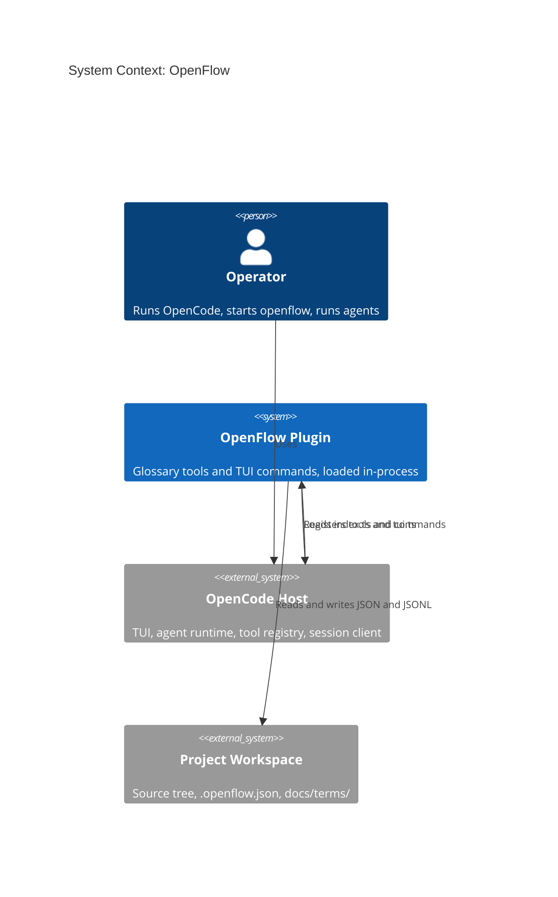
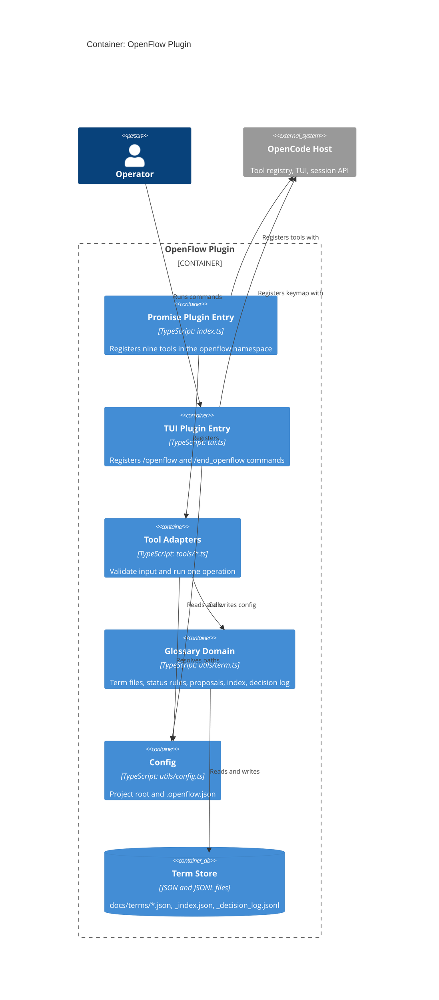
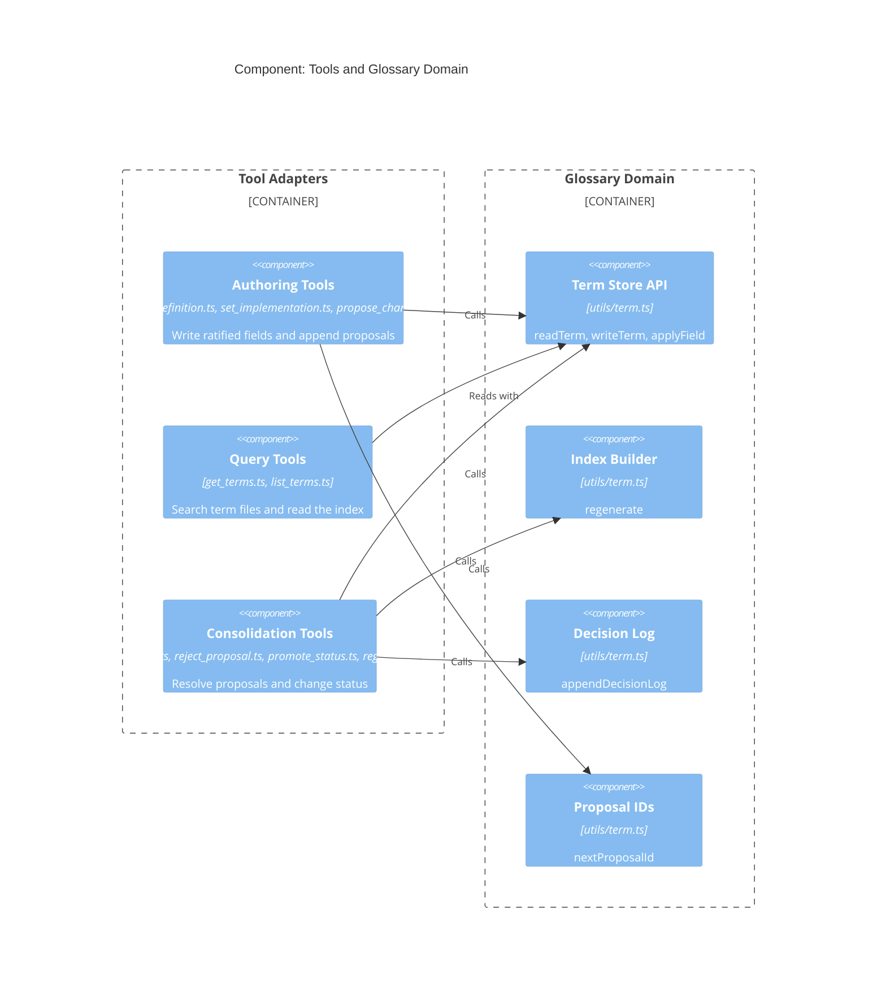
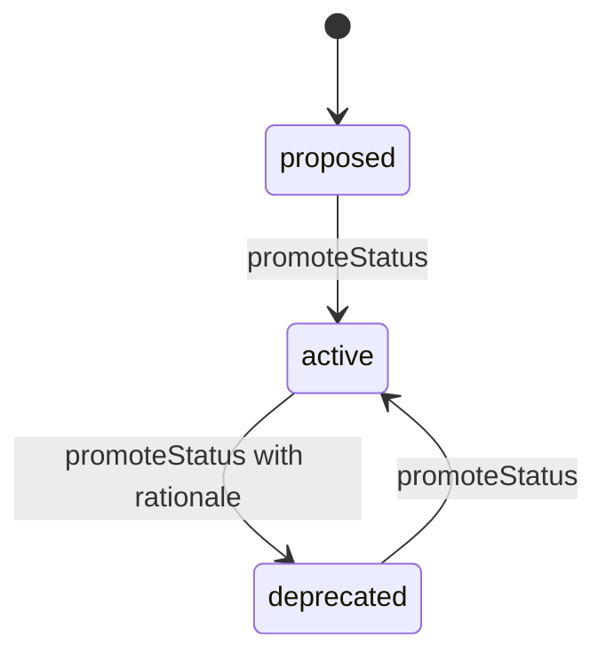

# Architecture

## Purpose

OpenFlow is an OpenCode V2 plugin. It gives agents a glossary of business terms and a controlled process for changing that glossary. The glossary is the shared vocabulary for a sprint. Agents read it, propose changes to it, and consolidate those changes at sprint end.

The plugin runs inside the OpenCode host. It has no server, no database, and no network access. The project file system is the only data store.

## Level 1: System Context



| Element | Responsibility |
|---|---|
| Operator | Starts the session and the openflow commands. Runs the agents. |
| OpenCode Host | Loads plugins. Provides the tool registry, the TUI, the keymap, and the session client. |
| OpenFlow Plugin | Registers nine glossary tools and two TUI commands. Enforces the glossary rules. |
| Project Workspace | Holds `.openflow.json` and the term store under the configured directory. |

The plugin does not call an LLM. Agents call the plugin's tools. The plugin validates the input and writes the term store.

## Level 2: Containers



| Container | Responsibility | Depends on |
|---|---|---|
| Promise plugin entry (`index.ts`) | Calls `initConfig`. Registers the nine tools in the `openflow` namespace. Contains no domain logic. | Tool adapters, config, host tool editor |
| TUI plugin entry (`tui.ts`) | Provides the active signal. Registers `/openflow` and `/end_openflow`. Creates or validates `.openflow.json`. | Config, state, commands, host keymap and dialogs |
| Tool adapters (`tools/*.ts`) | Hold one tool definition each: name, description, input schema, options, `execute`. | Glossary domain, schema, config |
| Glossary domain (`utils/term.ts`) | Owns term reads and writes, status transitions, proposals, index generation, and the decision log. | Config, file system |
| Config (`utils/config.ts`) | Resolves the project root and owns `.openflow.json`. | File system |
| Term store | One JSON file per term, a derived index, and an append-only decision log. | File system |

## Level 3: Components



| Component | Tools or functions | Rule it enforces |
|---|---|---|
| Authoring | `setDefinition`, `setImplementation`, `proposeChange` | A ratified field needs `force` to change. Proposals never change a ratified field. |
| Query | `getTerms`, `listTerms` | Read-only. No writes. |
| Consolidation | `applyProposal`, `rejectProposal`, `promoteStatus`, `regenerateIndex` | Only consolidation resolves proposals and changes status. |
| Term Store API | `readTerm`, `writeTerm`, `applyField` | One file per term. Slugified file names. Deprecated terms are immutable here. |
| Index Builder | `regenerate` | The index is derived from the term files. |
| Decision Log | `appendDecisionLog` | Append-only JSONL. |
| Proposal IDs | `nextProposalId` | `<year>-<sequence>`, sequence from `proposals.length + 1`. |

## Level 4: Code

### Directory structure

```text
plugins/openflow/
├── index.ts                    Promise plugin entry: registers tools
├── tui.ts                      TUI plugin entry: registers commands
├── commands/
│   └── end.ts                  /end_openflow command
├── data_loaders/
│   └── term_definitions.ts     Renders all terms for context injection
├── tools/
│   ├── set_definition.ts
│   ├── set_implementation.ts
│   ├── propose_change.ts
│   ├── get_terms.ts
│   ├── list_terms.ts
│   ├── apply_proposal.ts
│   ├── reject_proposal.ts
│   ├── promote_status.ts
│   └── regenerate_index.ts
└── utils/
    ├── config.ts               Root resolution and .openflow.json
    ├── term.ts                 Term I/O, status rules, proposals, index, log
    ├── schema.ts               JSON schema builders and ToolDefinition
    ├── state.ts                Active signal
    ├── helper.ts               slugify, err, isRecord, pick
    └── context.ts              Session creation helper
```

### Data shapes

```ts
interface OpenflowConfig {
  terms: { type: "file"; location: string; index: string }
}

type Status = "proposed" | "active" | "deprecated"

interface Proposal {
  id: string
  field: "definition" | "implementation"
  value: string
  proposed_by: string
  reason: string
  date: string
  resolved?: string
}

interface Term {
  term: string
  status: Status
  definition: string
  implementation: string
  aliases: string[]
  related_terms: string[]
  proposals: Proposal[]
}

interface IndexEntry {
  term: string
  status: Status
  aliases: string[]
  open_proposals: number
}
```

### Call flows

1. Set a ratified field:
   `setDefinition.execute` → `applyField` → `readTerm` → `writeTerm`.
   `applyField` rejects a deprecated term, returns a no-op for an equal value, and needs `force` for a different value. A forced overwrite appends a `superseded` proposal.
2. Propose a change:
   `proposeChange.execute` → `readTerm` → `nextProposalId` → push to `proposals` → `writeTerm`.
   The ratified field does not change.
3. Consolidate a proposal:
   `applyProposal.execute` → `readTerm` → set `term[field] = proposal.value` → set `proposal.resolved` → `writeTerm` → `appendDecisionLog`.
4. Regenerate the index:
   `regenerateIndex.execute` → `regenerate` → read every `*.json` that does not start with `_` → write `_index.json`.
5. Start a session:
   `/openflow` → `initConfig` → `getRootDir` → `configExists` → create or validate `.openflow.json` → `setActive(true)`.
6. End a session:
   `/end_openflow` → `setActive(false)` → toast.

## Term lifecycle



Rules:

- A new term starts as `proposed`.
- `deprecated` requires a rationale. The rationale is written to the decision log.
- `setDefinition` and `setImplementation` refuse to change a deprecated term.
- Only `promoteStatus` changes status.
- Only consolidation resolves proposals. Authoring agents append proposals.

## Invariants

1. One term is one file. The file name is `slugify(term.term) + ".json"`.
2. `_index.json` is derived. Never edit it by hand.
3. `_decision_log.jsonl` is append-only.
4. A proposal without `resolved` is open. `resolved` holds `accepted: <rationale>` or `rejected: <rationale>`.
5. A ratified field changes only through `force` or through an applied proposal.
6. Expected tool failures return `{ content: "ERROR: ..." }`. The plugin throws for a missing project root, a missing config file, or unreadable term data.
7. Tool input is validated by the host against the JSON schema. The `execute` function then casts the input to its expected shape.

## Quality attributes

| Attribute | How the design addresses it |
|---|---|
| Testability | Domain functions take a term name and read config. Tool adapters return strings. Tests use a temporary project root. |
| Portability | Only `node:fs` and `node:path`. No network, no database. |
| Traceability | Every accepted or rejected proposal and every status change lands in the decision log. |
| Simplicity | No build step. No generated code. The source is the artifact that OpenCode loads. |
| Recoverability | The term store is plain JSON in the project. Git provides history. |

## Known limitations

- Config root and active state are module-level values. One process serves one project root.
- There is no file locking. Two concurrent writers can interleave writes.
- Term files are not validated on read. A malformed file throws in `JSON.parse`.
- The index can be stale until `regenerate()` runs.
- The term store is the only integration point. There is no export format.
